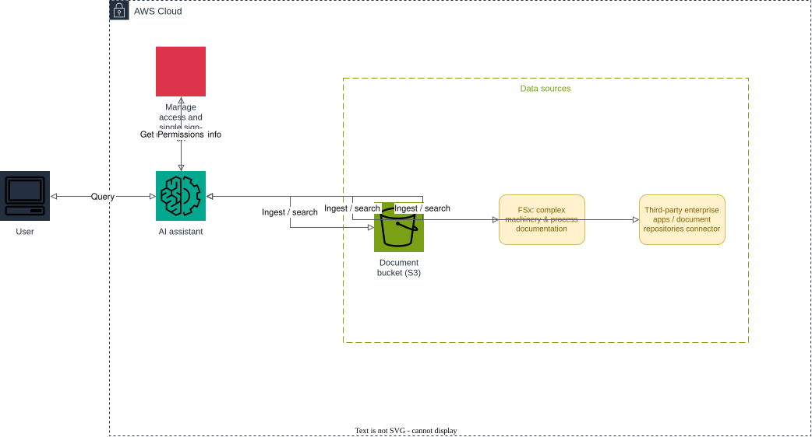

# AWS Project: AI Assistant with Data Sources

This architecture creates an enterprise AI assistant for machinery and maintenance
documentation that is permission-aware: before answering, it resolves the caller's
identity and group membership through single sign-on so every response is filtered
to only the data the requesting user is allowed to see.

1. a user sends a query (e.g. about machinery maintenance) to the `ai-assistant`
   Lambda function;
2. the AI assistant calls "Manage access and single sign-on" (represented by IAM
   groups, queried via `iam:ListGroupsForUser`) to resolve the user's identity and
   group membership;
3. the AI assistant ingests and searches the Data sources: the S3 document bucket,
   the FSx-hosted complex machinery and processes documentation (mirrored into the
   bucket for local search, since the emulator can't mount FSx into Lambda -- see
   the comment in [main.tf](main.tf)), and the third-party enterprise
   applications/document repositories connector, restricted to the prefixes the
   user's groups allow;
4. the AI assistant returns a permission-filtered response back to the user,
   generated from only the documents they were entitled to retrieve.

## Prerequisites

- Docker
- Terraform 1.5+
- AWS CLI

## Start Floci

```bash
docker compose up -d
```

## Apply Terraform

```bash
terraform init
terraform apply
```

Applying:

- creates the `document-store` S3 bucket with `general/`, `machinery/` and
  `partner-connector/` prefixes representing the S3, FSx and third-party connector
  data sources;
- provisions an EFS file system standing in for the FSx complex machinery and
  processes documentation data source (floci has no FSx/VPC support locally);
- creates two IAM groups (`maintenance-engineers`, `general-staff`) and demo IAM
  users representing SSO-managed identities with different data-source access;
- deploys the `ai-assistant` Lambda (with a public Function URL) that resolves the
  caller's groups, searches only the permitted data sources, and returns a
  permission-filtered, optionally Bedrock-generated answer.

## Architecture



The diagram source is a real, editable [draw.io](https://www.drawio.com/) file at
[docs/architecture.drawio](docs/architecture.drawio), generated programmatically with the
[drawpyo](https://github.com/MerrimanInd/drawpyo) Python library. Open the `.drawio` file directly
on GitHub or with the draw.io desktop app / [app.diagrams.net](https://app.diagrams.net/) to edit it.

To regenerate the diagram (`.drawio` source + the `.svg`/`.png` embedded above) after changing the
architecture:

```bash
python3 -m venv .diagram-venv
.diagram-venv/bin/pip install drawpyo
.diagram-venv/bin/python scripts/generate_diagram.py

# rasterize the .drawio file to svg/png (used by the README) via headless draw.io
docker run --rm -v "$PWD/docs":/data -w /data rlespinasse/drawio-export -f svg -o . --output-mode relative --remove-page-suffix .
docker run --rm -v "$PWD/docs":/data -w /data rlespinasse/drawio-export -f png -o . --output-mode relative --remove-page-suffix -t .
```

## Load documents into the data sources

Upload a few documents into each data-source prefix of the document store:

```bash
DOC_BUCKET=$(terraform output -raw document_store_bucket)

aws --endpoint-url http://localhost:4566 s3 cp ./safety-guide.txt "s3://$DOC_BUCKET/general/safety-guide.txt"
aws --endpoint-url http://localhost:4566 s3 cp ./press-machine-manual.txt "s3://$DOC_BUCKET/machinery/press-machine-manual.txt"
aws --endpoint-url http://localhost:4566 s3 cp ./vendor-maintenance-log.txt "s3://$DOC_BUCKET/partner-connector/vendor-maintenance-log.txt"
```

## Ask the assistant

```bash
ASSISTANT_URL=$(terraform output -raw ai_assistant_function_url)

# jane is in maintenance-engineers: sees general/, machinery/ and partner-connector/
curl -s -X POST "$ASSISTANT_URL" \
  -H "Content-Type: application/json" \
  -d '{"user": "floci-ai-assistant-jane", "query": "press machine maintenance schedule"}' | jq

# bob is in general-staff: only sees general/ documents
curl -s -X POST "$ASSISTANT_URL" \
  -H "Content-Type: application/json" \
  -d '{"user": "floci-ai-assistant-bob", "query": "press machine maintenance schedule"}' | jq
```

If you want to follow the execution, watch the Floci container logs:

```bash
docker compose logs -f floci
```

## Clean up

```bash
terraform destroy
docker compose down
```
